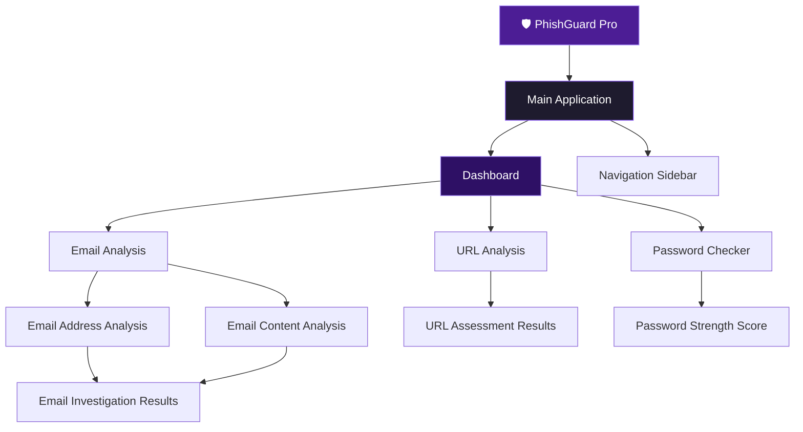

# 🛡️ PhishGuard Pro
### Phishing Detection & Cybersecurity Investigation Platform

<p align="center">
  
</p>

<p align="center">
  <strong>DETECT • ANALYZE • PROTECT</strong>
</p>

<p align="center">
  <strong>Detect Suspicious Links. Investigate Emails. Strengthen Passwords.</strong>
</p>

<p align="center">
  A modern cybersecurity investigation workspace designed to help users explore suspicious URLs, analyze phishing-related email indicators, and evaluate password strength through an intuitive dashboard.
</p>

<p align="center">
  
  
  
  
</p>

<p align="center">
  <a href="https://phishguard-pro-nine.vercel.app/">
    
  </a>
  <a href="https://github.com/Sanhita2006/phishguard-pro">
    
  </a>
</p>

---

## 📌 Table of Contents

- [Overview](#-overview)
- [Why PhishGuard Pro?](#-why-phishguard-pro)
- [Key Features](#-key-features)
- [Platform Modules](#-platform-modules)
- [Technology Stack](#-technology-stack)
- [System Architecture](#-system-architecture)
- [Project Structure](#-project-structure)
- [Installation](#-installation--setup)
- [Available Scripts](#-available-scripts)
- [Security & Privacy](#-security--privacy)
- [Future Enhancements](#-future-enhancements)
- [Contributing](#-contributing)
- [Author](#-author)

---

## 🚀 Overview

**PhishGuard Pro** is a web-based cybersecurity investigation platform designed to help users understand and explore common phishing-related security risks.

Phishing attacks are among the most common cybersecurity threats. Attackers use deceptive URLs, fraudulent emails, and social engineering techniques to trick users into revealing sensitive information.

PhishGuard Pro brings essential investigation tools into one centralized workspace, allowing users to explore suspicious URLs, examine email addresses and message content, and evaluate password complexity.

The platform features a modern dark-themed interface with a purple cybersecurity-inspired visual identity, providing an organized and user-friendly security workspace.

### 🎯 Our Mission

To make phishing awareness and basic cybersecurity investigation more accessible through simple, interactive, and intuitive tools.

---

## 💡 Why PhishGuard Pro?

Online phishing attacks continue to create risks for individuals and organizations.

PhishGuard Pro focuses on three important areas of everyday digital security:

- **Suspicious URLs:** Understand URL-related security indicators.
- **Email Security:** Explore suspicious email addresses and message content.
- **Password Protection:** Evaluate password complexity and encourage stronger password practices.

By combining these capabilities, PhishGuard Pro provides a convenient starting point for learning about phishing and digital security.

---

## ✨ Key Features

<table>
<tr>
<td width="50%">

### 🌐 URL Analysis
Investigate URLs and explore security-related indicators, including HTTPS and DNS information.

</td>
<td width="50%">

### 📧 Email Analysis
Examine suspicious email addresses and email message content for phishing-related indicators.

</td>
</tr>
<tr>
<td width="50%">

### 🔐 Password Checker
Evaluate password complexity using an interactive strength score and security checklist.

</td>
<td width="50%">

### 📊 Security Dashboard
Access the main investigation workspace and navigate between security tools.

</td>
</tr>
</table>

---

## 🧩 Platform Modules

### 01. 📊 Security Dashboard

The central workspace of PhishGuard Pro.

- Modern cybersecurity dashboard.
- Centralized security tools.
- Quick access to investigation modules.
- Dedicated navigation sidebar.
- Dark-themed interface.

### 02. 🌐 URL Analysis

A dedicated interface for investigating suspicious URLs.

**Features:**
- URL input and investigation workflow.
- Analysis loading state.
- Security assessment presentation.
- HTTPS-related security indicator.
- Threat assessment result interface.
- DNS-related information in the investigation workflow.

### 03. 📧 Email Analysis

An email investigation module with two dedicated analysis modes.

**Email Address Analysis**
- Enter an email address.
- Start an address investigation workflow.
- Review the analysis result interface.

**Email Content Analysis**
- Examine email message content.
- Explore phishing-related indicators.
- Review investigation results.

### 04. 🔐 Password Strength Checker

An interactive tool for evaluating password complexity directly in the browser.

**Password evaluation criteria:**

- Minimum 8 characters.
- Recommended 12 or more characters.
- Uppercase letters (A–Z).
- Lowercase letters (a–z).
- Numbers (0–9).
- Special characters.

**Password strength levels:**

| Score | Strength |
|---|---|
| 0–20% | Very Weak |
| 40–59% | Weak |
| 60–79% | Medium |
| 80–99% | Strong |
| 100% | Very Strong |

The strength score updates dynamically as the password is entered.

---

## 🛠️ Technology Stack

<p align="center">
  
</p>

| Technology | Purpose |
|---|---|
| React 19 | Component-based UI development |
| JavaScript (ES6+) | Application logic |
| Vite 8 | Development server and build tooling |
| Tailwind CSS 4 | Responsive interface styling |
| Lucide React | Icons and visual elements |
| Oxlint | Code linting |
| Git | Version control |
| GitHub | Repository hosting |
| Vercel | Live deployment |

---

## 🏗️ System Architecture

PhishGuard Pro uses a component-based React architecture.



---

## 📂 Project Structure

```text
phishguard-pro/
│
├── public/
│
├── src/
│   │
│   ├── components/
│   │   ├── Sidebar.jsx
│   │   ├── Dashboard.jsx
│   │   ├── UrlAnalysis.jsx
│   │   ├── EmailAnalysis.jsx
│   │   └── PasswordChecker.jsx
│   │
│   ├── App.jsx
│   ├── main.jsx
│   └── index.css
│
├── .gitignore
├── .oxlintrc.json
├── index.html
├── package.json
├── package-lock.json
├── vite.config.js
│
└── README.md
```

---

## ⚙️ Installation & Setup

Follow these steps to run PhishGuard Pro locally.

### Prerequisites

Make sure you have installed:

- [Node.js](https://nodejs.org/)
- npm
- [Git](https://git-scm.com/)
- [Visual Studio Code](https://code.visualstudio.com/) (Recommended)

### Step 1: Clone the Repository

```bash
git clone https://github.com/Sanhita2006/phishguard-pro.git
```

### Step 2: Navigate to the Project

```bash
cd phishguard-pro
```

### Step 3: Install Dependencies

```bash
npm install
```

### Step 4: Start the Development Server

```bash
npm run dev
```

### Step 5: Open in Browser

Open the local URL displayed in your terminal.

Usually:

```text
http://localhost:5173
```

🎉 PhishGuard Pro is now ready to run locally!

---

## 📜 Available Scripts

| Command | Description |
|---|---|
| `npm run dev` | Start the development server |
| `npm run build` | Create a production build |
| `npm run preview` | Preview the production build |
| `npm run lint` | Check code quality using Oxlint |

---

## 🔒 Security & Privacy

PhishGuard Pro is intended for educational purposes, cybersecurity awareness, and authorized investigation workflows.

**Important security considerations:**

- Never enter real passwords into demonstration tools.
- Avoid submitting confidential email content.
- Only investigate URLs and systems you are authorized to assess.
- Do not assume HTTPS alone guarantees that a website is safe.
- Always verify suspicious messages through trusted channels.

**Implementation note:** The current URL and email investigation interfaces use simulated analysis workflows and predefined demonstration results. They should not be treated as verified live phishing detection or real-time threat intelligence services. The password checker evaluates complexity using client-side criteria and is not a substitute for a secure password auditing service.

---

## 🔮 Future Enhancements

Planned possibilities for future development:

- [ ] Integrate real-time URL reputation checking.
- [ ] Add phishing detection APIs.
- [ ] Integrate email authentication checks (SPF, DKIM, DMARC).
- [ ] Improve email phishing indicator detection.
- [ ] Add domain and DNS intelligence integrations.
- [ ] Introduce advanced password security recommendations.
- [ ] Add downloadable investigation reports.
- [ ] Improve security analytics and visualizations.
- [ ] Enhance mobile responsiveness.
- [ ] Add automated security testing.

---

## 🤝 Contributing

Contributions, ideas, and suggestions are welcome!

To contribute:

1. Fork this repository.
2. Create a feature branch.
3. Make your changes.
4. Commit your changes.
5. Submit a Pull Request.

```bash
git checkout -b feature/your-feature-name

git add .

git commit -m "Add: your feature description"

git push origin feature/your-feature-name
```

---

## 👩‍💻 Author

<p align="center">
  
</p>

<h3 align="center">Sanhita Bhattacharjee</h3>

<p align="center">
  B.Tech Computer Science & Engineering<br/>
  Cybersecurity Enthusiast | Developer | Technology Explorer
</p>

<p align="center">
  <a href="https://github.com/Sanhita2006">
    
  </a>
</p>

---

## ⭐ Support the Project

If you find PhishGuard Pro interesting:

- ⭐ Star the repository.
- 🍴 Fork the project.
- 💬 Share your feedback.
- 🤝 Contribute new ideas and improvements.

Every bit of support helps the project grow!

---

<p align="center">
  
</p>

<p align="center">
  <strong>🛡️ PhishGuard Pro — Making the Digital World Safer.</strong>
</p>
